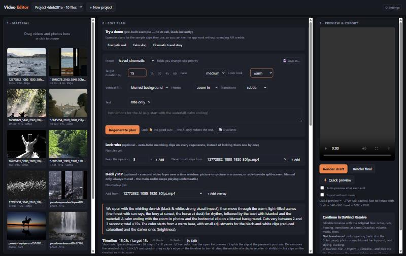

<h1 align="center">Video Editor</h1>

<p align="center">
  <b>Turns raw footage — clips, photos, a song — into a finished vertical video for social media.</b><br>
  An AI (Claude) proposes the cut, the color and the on-screen text. You can change or lock anything before it renders.
</p>

<p align="center">
  <i>Python · FastAPI · ffmpeg · Claude API</i>
</p>



### At a glance

| | |
|---|---|
| **What** | Local web app: FastAPI backend, single-file JS frontend, ffmpeg for rendering, Claude for the editing decisions. Windows. |
| **My role** | Product idea, UX, the "AI decides, code executes" architecture, and all testing. Built in pair-programming with Claude — see [How it was built](#how-it-was-built). |
| **Quality** | Every stage tested by hand: the render pipeline, the AI planner, the server and UI. Harder features (overlays, audio timing, beat sync) were checked against purpose-built test clips with exact pixel/frequency checks, not just "it ran." A dedicated robustness pass found and fixed 4 real crash/data-loss bugs — details in [CLAUDE.md](CLAUDE.md#10-robustness-audit-fixes-applied). The edit-plan validation (the code that checks the AI's JSON before anything renders) has 27 automated tests in [`tests/test_edl.py`](tests/test_edl.py). The AI request loop has 16 more in [`tests/test_planner_loop.py`](tests/test_planner_loop.py): what happens when a reply is cut off, refused, plain text instead of a tool call, an invalid plan, or two tool calls at once, using a fake AI client, so no API call is made. Both run in CI on every push; rendering, audio and the UI are still tested by hand. |
| **Status** | Personal/portfolio project, all planned features implemented. Two (Whisper subtitles, DaVinci import) are still untested on a normal install — see [Known limitations](#known-limitations-honest). |

## Why it exists

Hand-editing a 30-second reel — picking the best moments, cutting to a beat, adding text — takes about an hour. This app gets a solid first draft in two minutes: drop in clips and photos, pick a style, and the AI plans the edit. You stay in control: adjust anything, **lock 🔒** what already works, and regenerate only the rest.

## What it does

**AI editing**
- Claude picks the order, cuts, color and text, and returns a plan the code validates before it ever touches ffmpeg — the AI never writes ffmpeg itself.
- Lock any cut or text you like; regenerating only reworks what's unlocked.
- Standing lock rules ("keep the opening 3s", "never touch this file") apply automatically on every regeneration.
- Up to 3 different AI takes in one pass, so you compare instead of re-rolling one at a time.
- Deep scan: re-examine one ambiguous cut with 20 frames instead of 4, without touching the rest of the timeline.
- Per-file overrides the AI can't fight: mark a clip required or excluded, lock its usable range, fix its color — the code enforces these as hard limits.

**Manual editing, once the AI draft lands**
- Full NLE-style toolkit: undo/redo, keyboard shortcuts, drag-trim, a split tool, per-clip speed (0.25×–4×, with ½× / 1× / 2× / 4× buttons), manual pan/reframe, a waveform display, multi-select.
- A demo, a regenerate or a picked variant asks before it replaces your hand edits, and the previous plan stays one Undo away.
- **Simple mode** by default on a first visit: the essentials (files, demos, the plan, per-clip edits, music, preview and export), with **All features** one click away in the header and every group still switchable in Settings.
- Plan errors in plain words, with the clip numbers you see on screen (e.g. "The transition into clip 3 (0.3 s) is too long for clips this short…"), and a one-click fix for a transition that no longer fits.
- B-roll, picture-in-picture, and split-screen overlays.
- J/L cuts — a clip's sound can start early or run past its picture, the way editors hide a hard cut.
- Beat-synced zoom punches on the music.
- Free-drag text placement.

**Audio and music**
- Custom beat detection in plain numpy (no external library) finds the BPM and beat grid.
- Cuts can snap to the beat; the original clip audio ducks automatically under the music.
- A second ambience layer (room tone, rain, crowd) under the music.
- 5 bundled sound effects, placed anywhere on the timeline.

**Previews and export**
- Live quick-preview: only re-encodes the clips you changed, kept fully separate from the real export path so a low-quality preview can never leak into a final render.
- Optional subtitles (Whisper), recalculated live from the current timeline so they never go out of sync with your edits.
- Export a finished MP4, or an FCPXML timeline that reopens your *original* files in DaVinci Resolve / Final Cut.
- Try 3 demo edits instantly, no API key needed. Without a key, the AI button says so in plain words and points to these demos.

Everything above is optional and toggleable — a Settings panel keeps the interface uncluttered, and a right-click menu on a clip mirrors the main actions.

## How it's built

- **The AI never writes ffmpeg.** `planner.py` calls Claude; `edl.py` validates the result (overlaps, transitions, text) before `render.py` runs anything. An invalid plan gets one retry with the validation error.
- **Beat tracking from scratch.** `music.py` runs onset detection and dynamic-programming beat tracking in plain numpy — no external beat library.
- **Subtitles are recomputed, never stored.** `subtitles.py` derives timing from the transcript and the current cut list on every render, so moving a clip can't desync a caption.
- **Hard constraints vs. AI suggestions are kept separate.** `hints.py` enforces what you fix on a file regardless of what the AI proposes.
- **ffmpeg orchestration.** `render.py` normalizes every clip, applies `xfade`/concat for transitions and `drawtext` for text, then mixes original audio with music.
- **FCPXML export.** `fcpxml.py` builds a DaVinci/Final Cut timeline against the *original* files, validated against OpenTimelineIO for frame accuracy.
- **Overlay compositing** runs after the main timeline and before text, so captions stay visible on top of a PIP/split layer.
- **Beat punches use `zoompan`, not `crop`** — this ffmpeg build can't animate `crop` per frame, so the zoom pulse drives `zoompan` instead (found by reading `ffmpeg -h filter=crop` after the obvious approach failed).
- **The live-preview cache is walled off from real exports.** `render()` never receives a cache directory or sees proxy media, so a preview-quality segment can't end up in a final render.
- **Hardened against partial failures.** A single bad upload used to take the whole project down; each file is now probed independently, project state is written atomically, and finished jobs are pruned so a long session doesn't leak memory.

The full technical write-up — every decision above, explained in depth — is in [CLAUDE.md](CLAUDE.md).

| Module | Role |
|---|---|
| `app/probe.py` | ffprobe metadata |
| `app/edl.py` | the plan's schema + validation (overlaps, transitions, text, overlays) |
| `app/hints.py` | per-file settings: constraints (checked) and overrides (applied by code) |
| `app/lockrules.py` | standing lock rules (opening seconds / by source file), re-applied before every regeneration |
| `app/presets.py` | presets + the rules handed to the AI |
| `app/frames.py` | frames for the AI, thumbnails, example-video pacing |
| `app/music.py` | beat tracking in plain numpy, energy curve, beat alignment |
| `app/proxy.py` | background low-res proxies for previews/AI frames (render.py never touches these) |
| `app/planner.py` | the prompt + Claude call + validation retry + re-inserting locked items; also deep-scan and multi-variant generation |
| `app/render.py` | segments → overlays → transitions/text → beat punches → audio → MP4; plus the cached quick-preview path |
| `app/subtitles.py` / `app/transcribe.py` | Whisper → timeline-synced subtitles |
| `app/fcpxml.py` | DaVinci Resolve / Final Cut export |
| `app/main.py` | FastAPI server + background jobs |
| `static/index.html` | the whole UI (one file) |

## Getting started

Needs Python **3.10+**, **ffmpeg** on PATH, and an Anthropic API key:

```
py --version
ffmpeg -version                         # if missing: winget install Gyan.FFmpeg
py -m pip install -r requirements.txt
```

1. Copy `.env.example` to **`.env`** and set `ANTHROPIC_API_KEY=sk-ant-...` (never put the real key in `.env.example` — that file is the one tracked in git).
2. Double-click `start.bat`. It opens `http://localhost:8000`. Keep the window open — closing it stops the app. Stop with `Ctrl+C`.

Optional, for automatic subtitles (Whisper):
```
py -m pip install -r requirements-whisper.txt
```
The model downloads on first use (~460 MB, `small`). A smaller model is available via `VEDIT_WHISPER_MODEL=base`, at some accuracy cost.

**To try the 3 demo plans without an API key**, upload a project with these exact Pexels sample filenames (any free Pexels clips/photos renamed to match work — see `app/demo_presets.py` for the full list): `16928481_1080_1920_50fps.mp4`, `16581829_1440_2560_60fps.mp4`, `15940078_2160_3840_30fps.mp4`, `16615054_2160_3840_25fps.mp4`, `16931601_1080_1920_120fps.mp4`, `17198558_3840_2160_30fps.mp4`, `12772832_1080_1920_30fps.mp4`, plus 3 photos (`pexels-ayse-ela-dikye-49914919-16268987.jpg`, `pexels-hayriyenur-351892318-39457179.jpg`, `pexels-santesson89-37765467.jpg`). The demo buttons on a project missing any of those stay disabled with a tooltip naming what's missing.

## Browser demo (no install)

`site/` holds a static, backend-free recreation of the interface — the same ten sample files, the same three edit plans and reasoning as the "Try a demo" buttons above, and a real ffmpeg-rendered draft video — for anyone who wants to see the UI without installing Python, ffmpeg, or getting an API key. Open [site/index.html](site/index.html) locally, or see it hosted live (link once deployed). It's a plain static page: no build step, nothing it calls back to this app.

## Known limitations (honest)

- **The AI only sees 4 frames per clip.** It picks well on calm footage but can miss the exact right moment in a clip with a lot of action. Workaround: set an allowed range and a note for the AI on that file.
- **Beat tracking is tested on synthetic tracks** (128 and 95 BPM, ~22ms error). On music without a clear drum hit it can get it wrong — turn off "On beat" for that track.
- **Whisper and the DaVinci import are still untested on a normal network/install.** Whisper's model download is blocked in the sandboxed environment this was developed in; the subtitle *logic* was verified with a simulated transcript, and the FCPXML timing was validated against OpenTimelineIO, but neither has been exercised for real yet.
- **No YouTube support, on purpose** — downloading from it breaks YouTube's terms, and licensed music gets muted or claimed on most platforms anyway. For TikTok/Reels, export without music and add the same track from inside the app.
- Uploaded files are copied into the project folder, so a project's disk footprint adds up.
- **The FCPXML export doesn't carry over every manual tool**: speed changes, manual pan/crop, freely-dragged text, overlays, and beat punches stay specific to this app's renderer and don't reach DaVinci/Final Cut — redo those by hand there if you want to keep the look. Everything else (cuts, color look's base values, transitions-as-dissolve, music) does transfer.
- **A clip's waveform only shows up if the clip has its own audio.** Silent b-roll (most stock footage, including this project's own Pexels demo clips) has nothing to draw — expected, not a bug.

## API cost

One plan generation costs roughly 18–22k input tokens and 2–3k output tokens for 10 files (~31 frames) — a few cents per run. Excluded clips are never sent to the AI.

## How it was built

I own the product: I picked the idea (I kept hand-editing the same kind of 30-second clip and wanted the first draft automated), decided the "AI decides, code executes" boundary, and tested every stage by hand against real footage.

The code was written in pair-programming with Claude (Anthropic's AI assistant), starting from a written requirements doc and working through the pipeline stage by stage: metadata and plain-ffmpeg rendering first, then frame sampling and the AI planner, then the FastAPI server and UI, then music/beat sync, subtitles and the DaVinci export. A later pass added overlays, J/L-cut audio, beat-synced punches, a cached live preview, a Settings panel, and a dedicated robustness audit. The deeper technical write-up of how each piece works lives in [CLAUDE.md](CLAUDE.md) — the same file used as working context while building it.

## License

[MIT](LICENSE).
